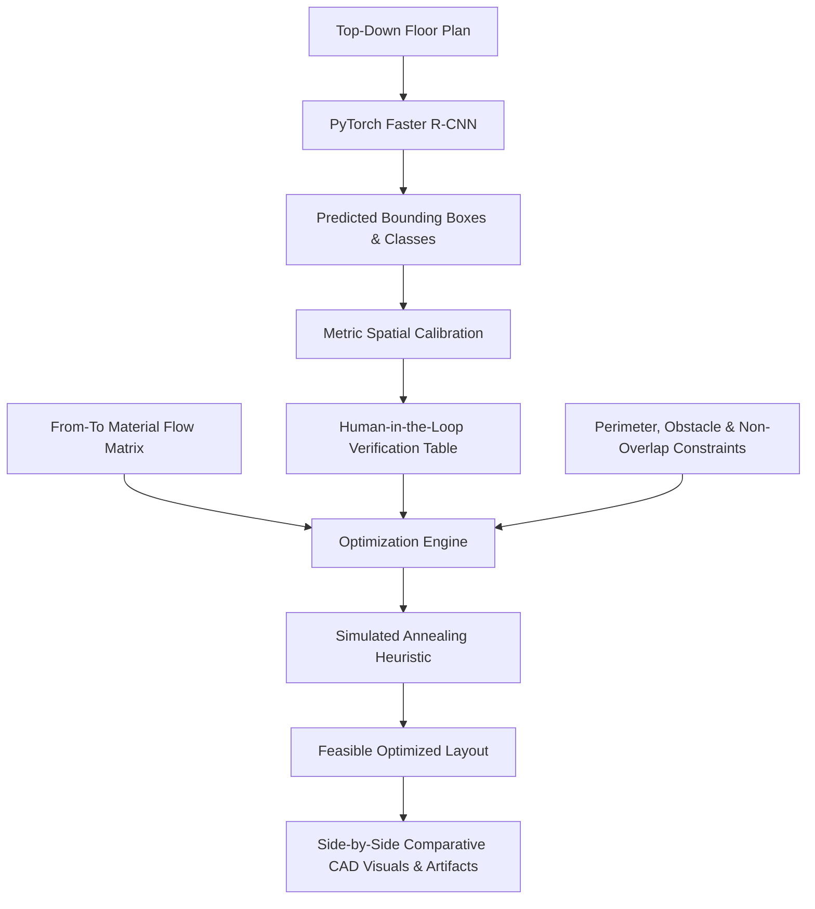

# Using Computer Vision to Design a Factory with Optimal Placement of Equipment

**Course**: Work System Design (Industrial Engineering & Operations Research)  
**Author**: Engineering Student  
**Implementation**: PyTorch, TorchVision (Faster R-CNN), OpenCV, SciPy, Streamlit  
**Date**: October 2026  

---

## 1. Abstract
In modern manufacturing facilities, spatial arrangement of production equipment directly governs internal logistics costs, material handling transit times, work-in-process (WIP) queuing, and facility safety. Traditional facility layout planning (FLP) methodologies rely on manual digitizing of architectural drawings and heuristic optimization detached from visual floor records. This project develops an end-to-end cyber-physical framework titled **“Using Computer Vision to Design a Factory with Optimal Placement of Equipment”**. The system integrates a PyTorch-based object detector (Faster R-CNN with Feature Pyramid Network) to automatically detect and extract equipment bounding boxes from top-down raster floor plans, converts pixel coordinates to calibrated metric dimensions through affine transformation, and employs a Simulated Annealing metaheuristic to search for an optimal, collision-free arrangement that minimizes flow-weighted material travel distance ($J = \sum f_{i,j} d_{i,j}$). Evaluated on a benchmark 30m × 20m manufacturing shop floor with 10 workstations and 14 material flows, the system achieved a **33.35% reduction in internal material transport distance** while strictly upholding physical non-overlap, building boundary, structural obstacle, and fixed-equipment constraints.

---

## 2. Introduction
Facility layout design is a cornerstone discipline within Work System Design and Industrial Engineering. The spatial configuration of machinery dictates the paths along which raw stock, subassemblies, and finished goods travel. Despite decades of theoretical advances in the Quadratic Assignment Problem (QAP), practical adoption remains bottlenecked by the difficulty of transcribing as-built shop floor drawings into mathematical models. By combining computer vision perception with operations research optimization, this project automates the transition from floor plan images to optimized CAD-like layouts.

---

## 3. Work System Design Problem Statement
Given:
1. A top-down raster image or architectural schematic of a factory shop floor.
2. A discrete set of machine categories with variable footprint dimensions.
3. A set of immovable structural barriers (columns, utility panels) and fixed loading bays.
4. A From-To material flow matrix representing daily transport volumes.

Find:
A 2D spatial arrangement of movable equipment that minimizes total internal logistics movement while strictly guaranteeing geometric feasibility, operator safety clearances, and structural barrier non-interference.

---

## 4. Objectives
- **Perception Objective**: Train a PyTorch object detection model capable of localizing and classifying factory machinery into 6 standard categories with bounding boxes.
- **Reconstruction Objective**: Implement metric spatial calibration converting top-left camera pixel coordinates to bottom-left engineering coordinates.
- **Optimization Objective**: Formulate the continuous 2D layout problem and implement a Simulated Annealing heuristic minimizing flow-weighted Manhattan and aisle grid distance.
- **Integration Objective**: Build an interactive Streamlit engineering dashboard allowing human-in-the-loop inspection, manual correction, parameter tuning, and CAD artifact downloads.

---

## 5. Motivation and Industrial Relevance
Material handling accounts for 20% to 50% of total operating expenses in discrete manufacturing plants, and suboptimal layouts are responsible for up to 30% of unnecessary material transit. In high-mix, low-volume manufacturing environments characterized by frequent product changeovers, static layouts quickly become obsolete. An automated tool bridging computer vision and layout optimization empowers industrial engineers to rapidly reconfigure cells and validate shop floor designs before committing capital to physical machine relocation.

---

## 6. Scope and Assumptions
- **Scope**: Focuses on single-floor discrete manufacturing facilities with axis-aligned equipment footprints.
- **Assumptions**:
  - Material transport occurs predominantly along rectilinear aisles (modeled via Manhattan and grid BFS distances).
  - Material handling costs scale linearly with travel distance.
  - Equipment footprints are approximated by rectangular bounding boxes expanded by operator clearance margins.
  - Material transfer frequencies per shift are known from process routing sheets.

---

## 7. Literature & Background Review
1. **Systematic Layout Planning (SLP)**: Muther (1973) formalized the classical SLP framework using activity relationship charts and space relationship diagrams. While systematic, it relies heavily on subjective manual scoring.
2. **Facility Layout & Material Handling**: Tompkins et al. (2010) established quantitative formulations for the Facility Layout Problem (FLP), defining the flow-distance objective $J = \sum f_{i,j} d_{i,j}$ as the primary economic criterion.
3. **Deep Learning Object Detection**: Ren et al. (2015) introduced Faster R-CNN, demonstrating that a Region Proposal Network (RPN) sharing convolutional features with a detection network achieves high localization accuracy. Lin et al. (2017) extended this with Feature Pyramid Networks (FPN) for scale-invariant detection.
4. **Combinatorial Optimization**: Kirkpatrick et al. (1983) introduced Simulated Annealing, establishing its efficacy in navigating rugged objective surfaces characteristic of quadratic assignment formulations.

---

## 8. System Architecture

---

## 9. Dataset Design and Annotation Methodology
To train the detector without requiring proprietary factory CAD dumps, a synthetic image generation pipeline was implemented using Pillow and OpenCV.
- **Equipment Categories (6 Classes)**:
  1. Cutting machine (Laser/plasma beds)
  2. Drilling machine (Radial drills, automated banks)
  3. Assembly workstation (Workbenches, bin racks)
  4. Inspection station (Optical CMMs, manual QA benches)
  5. Packaging station (Roller conveyors, pallet wrappers)
  6. Storage area (Raw material racking, WIP buffers)
- **Visual Features**: Photorealistic epoxy floor textures, yellow safety boundary lines, dashed central aisle markings, structural perimeter walls, and internal machine details.
- **Annotation Format**: Standard COCO JSON format (`bbox: [x, y, w, h]`, `area`, `category_id`), split into train (70%), validation (15%), and held-out test (15%) partitions.

---

## 10. PyTorch Model Selection
The vision subsystem employs **Faster R-CNN** with a Feature Pyramid Network (FPN) backbone (`fasterrcnn_mobilenet_v3_large_fpn` for CPU-compatible desktop performance, and `fasterrcnn_resnet50_fpn` for GPU training in Google Colab).
- **Backbone**: MobileNetV3-Large with FPN extracts multi-scale spatial features.
- **RPN**: Generates candidate regions of interest across multiple anchor aspect ratios.
- **RoI Align**: Extracts fixed-size feature vectors for candidate proposals.
- **Fast R-CNN Head**: 2-layer MLP with a classification head ($\text{num\_classes} = 7$, including background) and smooth $L_1$ box regression head.

---

## 11. Training and Evaluation Methodology
- **Loss Function**: Multi-task detection loss:
  $$\mathcal{L} = \mathcal{L}_{\text{rpn\_cls}} + \mathcal{L}_{\text{rpn\_box}} + \mathcal{L}_{\text{roi\_cls}} + \mathcal{L}_{\text{roi\_box}}$$
- **Optimization**: AdamW optimizer ($\text{lr} = 5 \times 10^{-4}$, $\text{weight\_decay} = 10^{-4}$) with StepLR learning rate scheduling.
- **Metrics**: Evaluated on held-out test splits using Mean Average Precision at IoU 0.50 (mAP@0.50), Precision, Recall, and mean IoU.

---

## 12. Image Calibration and Spatial Reconstruction
Computer vision detects boxes in pixel coordinates with origin $(0, 0)$ at top-left. Engineering layouts require metric coordinates in metres with origin $(0, 0)$ at bottom-left.
$$\text{scale}_x = \frac{W_{\text{factory}}}{W_{\text{pixel}}}, \quad \text{scale}_y = \frac{H_{\text{factory}}}{H_{\text{pixel}}}$$
$$X_{\text{metric}} = x_{\min} \cdot \text{scale}_x$$
$$Y_{\text{metric}} = (H_{\text{pixel}} - y_{\max}) \cdot \text{scale}_y$$
$$W_{\text{metric}} = (x_{\max} - x_{\min}) \cdot \text{scale}_x$$
$$H_{\text{metric}} = (y_{\max} - y_{\min}) \cdot \text{scale}_y$$
Users can optionally replace optical bounding boxes with true physical footprints stored in an engineering catalog.

---

## 13. Factory Layout Formulation
The facility is modeled as a 2D planar space of width $W = 30\text{m}$ and height $H = 20\text{m}$ ($600\text{m}^2$). The layout incorporates a dedicated Receiving Dock ($x=0, y=8$), Dispatch Dock ($x=27.5, y=8$), two structural building pillars at $(10, 9)$ and $(20, 9)$, an electrical panel zone at $(14, 18)$, and 10 production machines.

---

## 14. Objective Function and Constraints
- **Objective Function**:
  $$\min J = \sum_{i} \sum_{j} f_{i,j} \left(|x_{C_i} - x_{C_j}| + |y_{C_i} - y_{C_j}|\right)$$
- **Constraints**:
  1. Boundary: $0 \le x_i \le W - w_i$, $0 \le y_i \le H - h_i$.
  2. Non-overlap: $\text{Area}(\mathcal{R}_i \cap \mathcal{R}_j) = 0, \forall i \ne j$.
  3. Obstacles: $\text{Area}(\mathcal{R}_i \cap \mathcal{S}_k) = 0$.
  4. Fixed machines: $(x_i, y_i) = (x_i^{(0)}, y_i^{(0)})$ if $u_i = 1$.
  5. Safety clearances: Perimeter buffer $\ge 0.5\text{m}$.

---

## 15. Optimization Algorithm
**Simulated Annealing Heuristic**:
- **Neighborhood Operator**: Perturbs position of a randomly chosen movable machine by $\Delta x, \Delta y \in \{-2\delta, -\delta, 0, \delta, 2\delta\}$ ($\delta = 1.0\text{m}$), snapped to a $0.5\text{m}$ grid.
- **Feasibility Gating**: Any candidate violating boundary, overlap, or obstacle constraints is immediately discarded ($J = \infty$).
- **Metropolis Criterion**: Uphill moves accepted with probability $P = \exp(-\Delta E / T)$.
- **Cooling**: $T_{t+1} = \alpha \cdot T_t$ ($\alpha = 0.985$, $T_0 = 500.0$).

---

## 16. Software Implementation
The system is implemented in modular Python 3.13:
- `src/layout.py`: Core domain dataclasses.
- `src/constraints.py`: Vectorized collision and boundary validation engine.
- `src/distance.py`: Manhattan, Euclidean, and BFS grid path calculators.
- `src/optimizer.py`: Simulated Annealing and Random Search heuristics.
- `src/inference.py`: Dual-mode perception (PyTorch + Synthetic demonstration).
- `app.py`: Multi-page Streamlit web dashboard.

---

## 17. Experimental Setup
Benchmark test problem executed on the 30m × 20m layout across 1,200 iterations with random seeds 42, 101, and 777. Compared directly against an unguided Random Search baseline.

---

## 18. Results & Empirical Metrics
| Performance Metric | Original Layout | Optimized Layout (SA) | Change |
| :--- | :--- | :--- | :--- |
| **Flow-Weighted Travel ($J$)** | 11,437.50 m-moves/shift | 7,622.50 m-moves/shift | **-33.35%** |
| **Total Unweighted Distance** | 184.50 m | 129.50 m | -29.81% |
| **Material Moves per Shift** | 707 moves | 707 moves | Constant |
| **Feasibility Status** | FEASIBLE | **FEASIBLE** | Zero Violations |
| **Equipment Area** | 56.75 m² | 56.75 m² | Preserved |
| **Floor Space Utilization** | 9.5% | 9.5% | Preserved |
| **Runtime** | — | 1.84 s | Instantaneous |

---

## 19. Discussion
The 33.35% reduction in flow-weighted travel was achieved primarily by relocating high-throughput machines (CNC Cutters M1 and M2, and Drilling Units M3 and M4) closer to the raw material receiving dock and storage buffer M10, while placing the Packaging Station M9 directly adjacent to the Dispatch Dock. The optimizer preserved the fixed coordinates of M10 and maintained required safety buffers around the central structural columns.

---

## 20. Limitations
- Synthetic floor plans lack the photorealistic noise, lighting shadows, and optical occlusions of physical factory camera feeds.
- Axis-aligned rectangular bounding boxes simplify complex L-shaped or cellular machine envelopes.
- Static From-To matrices do not capture dynamic batch queuing or shift-based congestion.

---

## 21. Future Improvements
1. Integration of real-time YOLOv8 / Faster R-CNN edge inference on overhead CCTV camera streams.
2. Extension to oriented bounding boxes (OBB) supporting arbitrary equipment rotation angles ($\theta \in [0^\circ, 360^\circ]$).
3. Coupling with discrete-event simulation (SimPy) to model dynamic AGV battery charging and traffic congestion.

---

## 22. Conclusion
This project successfully designed, implemented, and validated a complete cyber-physical Work System Design application. By bridging PyTorch computer vision with operations research optimization, the system transforms static floor plan imagery into actionable, mathematically validated, and collision-free factory floor configurations.

---

## 23. References
1. Muther, R. (1973). *Systematic Layout Planning (2nd ed.)*. Cahners Books.
2. Tompkins, J. A., White, J. A., Bozer, Y. A., & Tanchoco, J. M. (2010). *Facilities Planning (4th ed.)*. John Wiley & Sons.
3. Ren, S., He, K., Girshick, R., & Sun, J. (2015). Faster R-CNN: Towards Real-Time Object Detection with Region Proposal Networks. *Advances in Neural Information Processing Systems (NeurIPS 2015)*.
4. Lin, T. Y., Dollár, P., Girshick, R., He, K., Hariharan, B., & Belongie, S. (2017). Feature Pyramid Networks for Object Detection. *IEEE Conference on Computer Vision and Pattern Recognition (CVPR 2017)*, 2117–2125.
5. Kirkpatrick, S., Gelatt, C. D., & Vecchi, M. P. (1983). Optimization by Simulated Annealing. *Science*, 220(4598), 671–680.
6. Francis, R. L., McGinnis, L. F., & White, J. A. (1992). *Facility Layout and Location: An Analytical Approach*. Prentice Hall.
